# Yellowstone Project — Part 3: Park Visitation

*MATH F428 Time Series Analysis and Forecasting · Part 3 report · November 2026*

## Summary

Park-wide visitor numbers did not respond to the 1995 wolf reintroduction. The clearest climate signal is a season that is spreading into spring and autumn. Part 3 models 564 months of NPS recreation visits (January 1979 to December 2025) to answer five questions from the project brief.

- **Wolves (Q1).** Winter visits show no rise after 1995 (−15%, p = 0.54). The most precise model rules out a park-wide winter gain above 1.5%. North-gate winter cars, the road to Lamar Valley, doubled after 1996 and track the wolf count (elasticity ≈ 0.3), which is suggestive but not conclusive.
- **Climate (Q2).** Spring and autumn rose from 24% to 38% of yearly visits. A month 1 °C warmer brings about 3% more visitors, 5–9% in shoulder months, and the effect is immediate rather than lagged.
- **Shocks (Q3).** The 1988 fires, COVID and the 2022 flood were each over within 3–4 months. The flood cost the most visits (1.1–2.5M in its first year). Only COVID was followed by a rebound above normal.
- **Forecasting (Q4).** No model beats "same month last year" significantly. A SARIMA without the first difference, and equal-weight combinations, come closest.
- **North gate (Q5).** The doubling of winter traffic starts in 1997, one winter after the first free-roaming wolves. With only three pre-wolf winters this cannot be proven to be a wolf effect.

Code: `notebooks/13_visitation_eda_sarima.ipynb` (Q0, Q4) and `notebooks/14_visitation_interventions.ipynb` (Q1–Q3, Q5). All figures are in `reports/figures/`, all tables in `reports/tables/`.

---

## 1. Data

All visitation data come from the NPS Integrated Resource Management Applications (IRMA) visitor-use statistics for Yellowstone (YELL).

| Dataset | IRMA report | Period | Used for |
|---|---|---|---|
| Recreation visits by month | Recreation Visitors By Month | 1979–2025 (+ Jan–Oct 2026, preliminary) | all questions |
| Annual recreation visits | Annual Park Recreation Visits | 1904–2025 | cross-check |
| Vehicles by entrance, monthly | Traffic Counts by Location | 1993–2026 | Q1, Q5 |
| Monthly visitation comments | Monthly Visitation Comments By Park | 2004–2025 | `Note` column |
| Counting-method history | Park Visitor Use and Count Procedure Changes | 1968–present | 1993 and 2013 changes |
| Monthly mean temperature | Part 2 (3 SNOTEL stations) | 1984–2026 | Q2 |
| Winter severity index | Part 2 | 1967–2026 | Q1 control |
| Wolf population | Part 1 | 1995–2025 | Q1, Q5 |

**Cleaning** (`scripts/build_visitation_data.py`). The export was reshaped to one row per month. Checks: exactly 12 × 47 = 564 months with no gaps; every yearly sum matches the official annual total exactly (largest difference 0.000%). April 2020 is the only zero month (park closed for COVID). The 2026 months are kept but flagged as preliminary and left out of all modelling.

**Flagged months.** A `Note` column records the 1988 fires (Jul–Sep), the government shutdowns (Dec 1995–Jan 1996, Oct 2013, Jan 2018, Dec 2018–Jan 2019, Oct 2025), the COVID closure (Mar–May 2020), the June 2022 flood and its aftermath (Jun–Oct 2022), and new entrance counters (2014, 2021, 2022). The Dec 1995–Jan 1996 shutdown was not in the brief; it falls exactly at the start of the first wolf winter.

**Two data facts that shape the analysis.**

1. NPS switched from manual counts to **traffic-counter estimates in 1993**, two years before the wolf release. Every before/after-1995 comparison includes a 1993 control.
2. The entrance traffic file counts **wheeled vehicles only** and starts in **1993**. In winter only the North gate has cars (West, South and East are snowmobile-only; Northeast is unstaffed). This forced the change to Q5 described in Section 6.

---

## 2. Q0 — What does the series look like? Base SARIMA model

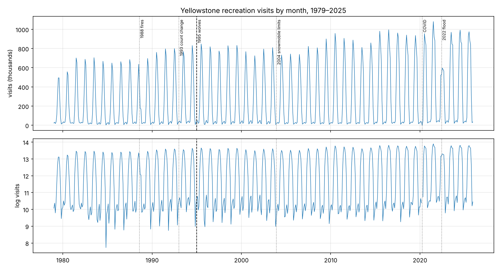

**Description.** Recreation visits rose from about 2.0M a year (1980) to 4.8M (2024–25). The season is extreme: on average July is about 66 times November. All models use **log visits**, which turns this multiplicative seasonal swing into an additive one.

**STL decomposition** (period 12, robust) separates trend, seasonal pattern and remainder. Plotting the seasonal component by decade already shows the summer peak shrinking relative to the shoulder months (Q2).

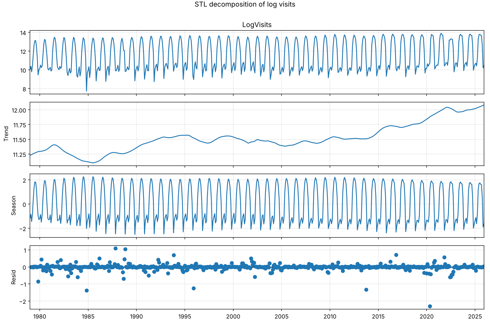

**Stationarity.** ADF tests the null of a unit root; KPSS tests the null of stationarity. statsmodels caps KPSS p-values at 0.10.

| Series | ADF stat | ADF p | KPSS stat | KPSS p |
|---|---|---|---|---|
| log V | −1.32 | 0.62 | 0.396 | 0.079 |
| Δ12 log V | −7.94 | < 0.01 | 0.056 | ≥ 0.10 |
| Δ1Δ12 log V | −9.85 | < 0.01 | 0.016 | ≥ 0.10 |

The level has a unit root. The seasonal difference alone is already stationary; adding the first difference keeps it stationary (see the over-differencing check below).

**Identification and selection.** The ACF/PACF of Δ1Δ12 log V show a negative spike at lag 12 (seasonal MA) and short-lag spikes (non-seasonal MA). A grid of 36 SARIMA(p,1,q)(P,1,Q)₁₂ models, each with shock dummies, was ranked by BIC among those whose residuals pass Ljung–Box at lag 24. The chosen model is **SARIMA(0,1,2)(1,1,1)₁₂** (BIC −22.9, Ljung–Box(24) p = 0.07). The airline model (0,1,1)(0,1,1)₁₂ has worse BIC and fails Ljung–Box.

```latex
(1 - \Phi B^{12})(1 - B)(1 - B^{12}) \log V_t = (1 + \theta_1 B + \theta_2 B^2)(1 + \Theta B^{12}) a_t + \beta' X_t
```

with θ₁ = −0.716, θ₂ = −0.220, Φ = 0.186, Θ = −0.833, σ² = 0.048.

| Regressor X_t | Effect on visits | p |
|---|---|---|
| 1988 fires (Jul–Sep) | −35% | < 0.001 |
| COVID closure (Mar–May 2020) | −65% | < 0.001 |
| 2022 flood (Jun–Oct) | −35% | < 0.001 |
| Shutdown months | −36% | < 0.001 |
| 1993 counting change (step) | +2% | 0.83 |
| 2013 counting change (step) | −10% | 0.37 |

**Diagnostics.** Residuals pass Ljung–Box at lags 12–36 but are heavy-tailed (kurtosis 14.8, Jarque–Bera p < 0.001), so the p-values above are approximate.

### Extensions to the base model

**Stationarity and invertibility (roots).** All AR and MA roots lie outside the unit circle, so the model is stationary and invertible. But the smallest MA root is **1.015**, and the non-seasonal MA polynomial almost vanishes at B = 1 (θ(1) = 1 + θ₁ + θ₂ = 0.064). An MA root this close to 1 is the textbook sign of **over-differencing**: the MA part is trying to cancel a difference that may not be needed.

**ARCH-LM test.** The ARCH-LM test finds changing residual variance over the full sample (p = 0.002 at 12 lags), but not in 1979–2019 (p = 0.23). This is not persistent volatility of the kind GARCH models describe; it is the 2020–22 cluster of extreme months (closure, record rebound, flood).

**Over-differencing check: d = 0 with drift.** Because Δ12 alone was stationary and the MA root sits near 1, a second family SARIMA(p,0,q)(P,1,Q)₁₂ with a constant was fitted. The best by BIC with clean residuals is **SARIMA(1,0,2)(1,1,1)₁₂ + drift** (Ljung–Box(24) p = 0.06), with a fixed long-run growth of +1.6% a year. Its shock estimates are almost identical to the d = 1 model. BIC cannot compare models with different d, so the two are compared out of sample in Q4.

**ψ-weights and the eventual forecast function.** Writing year-on-year growth z = Δ12 log V as an infinite MA shows how each model treats growth:

- with d = 1, the ψ-weights of z converge to ψ∞ = θ(1)Θ(1)/Φ(1) = **0.013**: every shock permanently changes the growth rate a little, so the forecast slope follows recent growth;
- with d = 0, the ψ-weights decay to **0**: shocks fade and growth returns to the fixed drift.

Ten years ahead from December 2019 the d = 1 model projects +3.5% a year and the d = 0 model +0.8%, against +2.8% actual over 1995–2019. This is the mechanism behind the d = 1 model's overshooting in Q4.

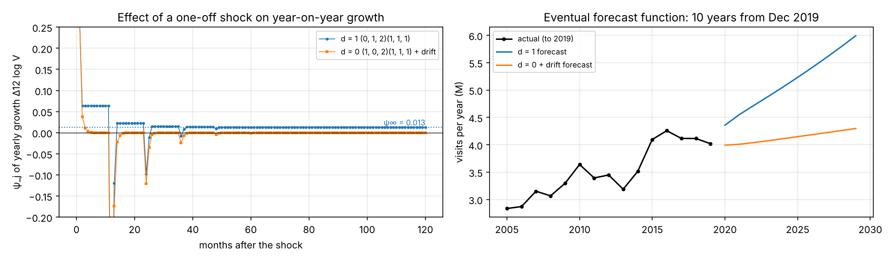

---

## 3. Q1 — Did wolves bring tourists?

**Approach.** In winter the only road open to cars runs through Lamar Valley, where wolves are watched, so the brief proposed winter visits as a measure of wolf tourism, with summer as the control. Wolves were released in January–March 1995 and 1996; the step starts in winter 1995–96 (labelled 1996), the first with free-roaming wolves. Intervention model (Box & Tiao 1975):

```latex
\log W_t = N_t + \omega S_t + \gamma' Z_t, \qquad S_t = 1 \text{ from winter 1996}
```

W_t = December–March visits (46 winters, 1980–2025), N_t = AR(1) with linear trend (best AIC of four candidates), Z_t = the 1993 counting change, the 2004 snowmobile rules, the winter severity index and the 1995–96 shutdown winter.

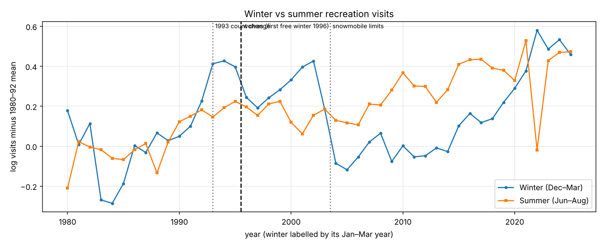

| Model | Change after wolves | 95% CI | p |
|---|---|---|---|
| Winter, step only | −15% | −50% to +44% | 0.54 |
| Winter, step + 1993 control | −16% | −53% to +49% | 0.55 |
| Winter, full controls | −22% | −78% to +174% | 0.70 |
| Winter, gradual ramp 1995–2000 | −22% | −59% to +46% | 0.43 |
| Winter, sample ends 2002 | −17% | −50% to +39% | 0.48 |
| Summer control | −8% | −21% to +6% | 0.25 |
| Winter − summer | −14% | −52% to +55% | 0.62 |

Every estimate is negative and none is significant. The yearly models are imprecise because the 1993 and 1996 steps are only three winters apart.

**Monthly version.** The full Q0 SARIMA on all 564 months, with a 1996 step allowed to differ between winter and summer months, is the most precise test. Winter months after 1996 are **17% lower** (p = 0.04); with winter severity added, 17% lower (p = 0.07, 95% CI −33% to +1.5%). This rules out a park-wide winter increase larger than about 1.5%. In the same model, the 2004 snowmobile rules cut winter visits by 30% (p = 0.01). Park-wide winter visits are mostly snowmobile and snowcoach trips from West Yellowstone to Old Faithful, far from wolf country, and they follow snowmobile policy, not wolves.

**North-gate winter cars vs the wolf population.** Cars entering through the North gate in winter go almost entirely to Mammoth and Lamar Valley. If wolves attract visitors, this traffic should rise and fall with wolf numbers. Log North-gate winter cars (1997–2021) were regressed on log wolves at the end of the previous year, with Highway 191 winter traffic as a control for the regional economy.

| Model | Elasticity (AR(1) errors) | p | Elasticity (OLS, HAC) | p |
|---|---|---|---|---|
| Wolves only | 0.31 | 0.048 | 0.27 | 0.11 |
| + Highway 191 | 0.30 | 0.090 | 0.32 | 0.12 |
| + Highway 191 + trend | 0.30 | 0.27 | 0.30 | 0.018 |
| Placebo: summer park visits | — | — | −0.13 | < 0.001 |

The elasticity of about 0.3 means 10% more wolves goes with about 3% more winter cars. It is stable across models, but its significance is not, and the placebo (summer visits on wolves, which should show nothing) comes out "significant" too. Two trending yearly series correlate easily, so this link is **suggestive, not proven**.

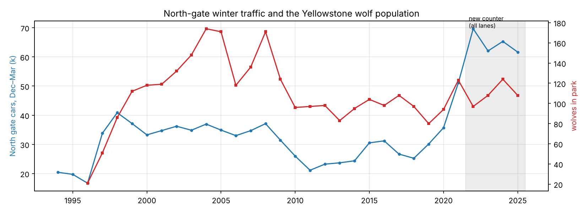

**Answer.** Did wolves bring tourists? Not in a way that shows up in park-wide visitor counts. Duffield, Neher & Patterson (2006) estimated wolf-related visitor spending at about $35.5M a year. That figure measures spending by visitors who came partly to see wolves, not extra visits, so it is not contradicted here: wolf watchers who would have visited anyway, or who come in summer, add spending without adding to winter counts. Any extra winter trips would be concentrated on the northern range, which is where the North-gate data hint at an effect.

---

## 4. Q2 — Is a warmer climate shifting when people visit?

**Season shape.** For each year, the shoulder share is visits in April, May, September and October divided by the yearly total; the centroid is the visit-weighted mean month. Trends were tested with Mann–Kendall and Sen's slope.

| Series, 1979–2025 | Trend | Sen slope | p |
|---|---|---|---|
| Shoulder share | increasing | +2.6 percentage points per decade | < 0.001 |
| Summer share (Jun–Aug) | decreasing | −2.2 percentage points per decade | < 0.001 |
| Visit centroid | none | — | 0.56 |
| Season spread (SD in months) | none | — | 0.58 |

The shoulder share rose from 24% (1979–83) to 38% (2021–25) while the centroid did not move: **the season is spreading at both ends, not shifting earlier or later.** The same holds for 1979–2019 alone, so COVID does not drive it.

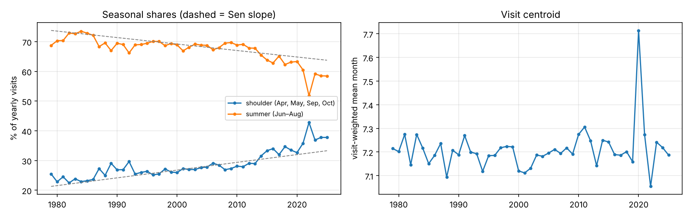

**Temperature regression.** Log visits on monthly mean temperature, month dummies, a linear trend, the counting-change steps and shock dummies, 501 months (1984–2025), Newey–West standard errors.

| Term | Effect per +1 °C | p |
|---|---|---|
| Common slope | +3.0% | < 0.001 |
| Non-shoulder months | +1.5% | 0.06 |
| Extra slope in shoulder months | +5.4% | < 0.001 |

Separate slopes by month: April +6.9%, May +4.9%, September +5.7%, October +9.1%, November +8.2%, but July −2.6% and August −2.2%. This matches Fisichelli et al. (2015): warming draws visitors where it is cool and starts to deter them at the peak.

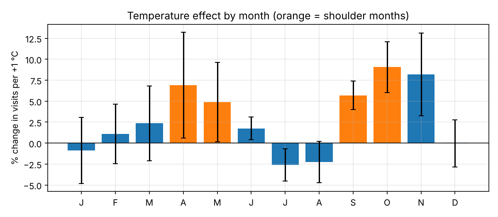

**Granger causality and VAR.** Does past temperature help predict visits beyond their own past? A VAR on year-on-year visitor growth (Δ12 log V) and year-on-year temperature change (Δ12 T), 1985–2019, both stationary (ADF p < 0.01, KPSS p ≥ 0.10), with fire and shutdown dummies as exogenous terms. BIC chose 0 lags, so VARs with 1, 2, 13 (HQIC) and 24 (AIC) lags were fitted.

A Granger test is only valid if the VAR's residuals are white noise, so each model's residuals were checked with Ljung–Box (lags 12 and 24, each series) and a joint portmanteau test (36 lags).

| Lags | Temperature → visits p | Visits → temperature (placebo) p | Instantaneous p | Ljung–Box p, residuals (temp / visits) | Residuals white? |
|---|---|---|---|---|---|
| 1 | 0.24 | 0.51 | < 0.001 | < 0.001 / < 0.001 | no |
| 2 | 0.25 | 0.51 | < 0.001 | < 0.001 / < 0.001 | no |
| 13 (HQIC) | 0.95 | 0.71 | < 0.001 | < 0.001 / 0.02 | no |
| **24 (AIC), main model** | **0.23** | **0.25** | **< 0.001** | **0.81 / 0.60** | **yes** |

Shorter VARs leave the yearly (lag 12 and 24) correlation from the Δ12 differencing in their residuals, so their Granger tests are not valid. The 24-lag VAR is the shortest whose residuals are white noise for both series, and it is the main model. In it, temperature does not Granger-cause visits (p = 0.23), the placebo direction is correctly non-significant (p = 0.25), and the same-month link is very strong. The other lag lengths agree. A joint whiteness test on both residual series still rejects (p < 0.001), so these p-values are approximate.

In the impulse response of the main model (temperature ordered first), a one-standard-deviation surprise (2.35 °C) raises same-month visitor growth by about 5.3%, roughly 2.3% per °C, close to the regression slope. **Visitors respond to the weather of the month they travel in, not last month's.**

**Caveats.** The temperature series warms by +0.42 °C per decade, but the number of SNOTEL stations varies between 1 and 3 by month. Road-opening dates, school calendars and summer crowding also shape the shoulder share and are not modelled.

---

## 5. Q3 — How fast does tourism recover from shocks?

**Counterfactual method.** For each shock the Q0 SARIMA was fitted up to the month before it and forecast 36 months ahead; the gap between forecast and actual is the shock's cost. Because SARIMA (d = D = 1) extrapolates pre-shock growth, the same was repeated with **ETS(M,N,M)**, which assumes no growth, as a robustness check. For the flood a second baseline trained to February 2020 treats 2019, not the record 2021, as normal.

| Shock | Worst month (SARIMA / ETS) | Visits lost, first 12 months (SARIMA / ETS) | Back in 95% band (SARIMA) | Year 2 vs normal (SARIMA / ETS) |
|---|---|---|---|---|
| 1988 fires (Jul 1988) | −56% / −39% (Sep 1988) | 702k / 156k | Oct 1988 (3 months) | −19% / +12% |
| COVID (Mar 2020) | −100% / −100% (Apr 2020) | 561k / 468k | Jun 2020 (3 months) | +7% / +14% |
| 2022 flood (Jun 2022) | −55% / −55% (Jul 2022) | 2.46M / 2.50M | Oct 2022 (4 months) | −25% / −20% |
| 2022 flood, pre-COVID baseline | −48% / −42% | 1.56M / 1.08M | Aug 2022 | −7% / +7% |

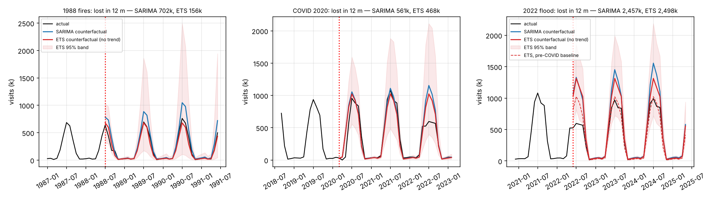

**Decay model.** Each shock was also fitted as a pulse decaying at rate δ, within the full-sample SARIMA:

```latex
\log V_t = N_t + \frac{\omega}{1 - \delta B} P_t, \qquad \text{half-life} = \frac{\ln 0.5}{\ln \delta}
```

statsmodels has no transfer-function estimator, so δ was profiled on a grid and the maximum-likelihood value kept.

| Shock (pulse month) | Immediate effect | δ (95% CI) | Half-life |
|---|---|---|---|
| COVID (May 2020) | −90% | 0.2 (0.1–0.3) | 0.4 months |
| 2022 flood (Jun 2022) | −49% | 0.8 (0.6–0.95) | 3.1 months |
| 1988 fires (Aug 1988) | −29% | 0.5 (0–0.95) | not identified |

The fire's δ is not pinned down because its damage grew from August into September, which a single decaying pulse cannot fit.

**Findings.**

- All three shocks were short: visits were back inside the normal range within 3–4 months.
- **COVID** is robust to the method: about 0.5M visits lost, followed by a real rebound (September–December 2020 +29%, 2021 +7% above the counterfactual; 2021 was 21% above 2019).
- **The fires** cost between 156k and 702k visits depending on the method. SARIMA's "still 19% down a year later" disappears once growth is not assumed (ETS +12%), so it reflects extrapolated 1980s growth, not lost visitors.
- **The flood** was the costliest shock under every method (1.1–2.5M visits), because it hit peak season and closed both northern entrances for four months. Against 2019 as normal, the second year was roughly back to normal (−7% to +7%).

---

## 6. Q4 — How well can monthly visits be forecast?

**Design.** Five models were refitted at every month-end from December 2009 to November 2025 (192 origins) and forecast 1 and 12 months ahead: seasonal naive (same month last year), the Q0 SARIMA (d = 1), SARIMA with d = 0 + drift, Holt–Winters (additive trend, multiplicative seasonality) and ETS(M,N,M) (chosen by AIC among 12 specifications). Targets in 2010–2019 are the main test; 2020–2025 (COVID, flood) is scored separately. Metrics: MAE, MAPE and MASE (Hyndman & Koehler 2006; scale = in-sample seasonal-naive MAE, 1979–2009).

| Model | MASE h = 1 | MAPE h = 1 | MASE h = 12 | MAPE h = 12 | MASE h = 1, 2020–25 |
|---|---|---|---|---|---|
| SARIMA d = 0 + drift | **1.18** | 12.7% | 1.39 | 13.7% | **2.72** |
| Holt–Winters | 1.28 | 14.7% | 1.46 | 15.6% | 3.04 |
| Seasonal naive | 1.28 | 14.0% | **1.24** | 13.9% | 4.12 |
| ETS(M,N,M) | 1.38 | 13.6% | 1.33 | 13.5% | 3.42 |
| SARIMA d = 1 (Q0) | 1.41 | 13.8% | 1.55 | 14.8% | 3.95 |

The Diebold–Mariano test finds no significant difference between the top two models at either horizon (p = 0.48 at h = 1, 0.46 at h = 12). The seasonal pattern is so stable that last year is already a very good forecast. Errors concentrate in October (about 40%), November and April, whose size depends on road opening and closing dates, early snow and the 2013 shutdown; summer errors are 5–7%. The d = 0 model is a clear improvement on the d = 1 model, confirming the over-differencing diagnosis from Q0.

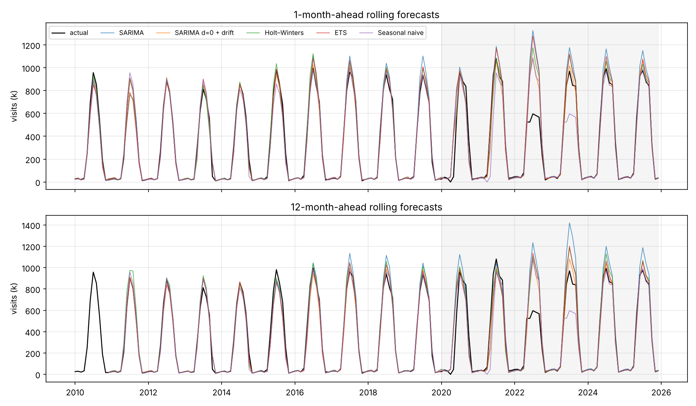

**Forecast combination.** Equal-weight averages of fixed sets of models, and real-time Bates–Granger weights (inverse MSE of past errors), were scored the same way.

| Best at horizon | Model | MASE 2010–19 | vs best single model (Diebold–Mariano p) |
|---|---|---|---|
| h = 1 | Combo: ETS + Holt–Winters + seasonal naive | 1.14 | SARIMA d = 0, 1.18 (p = 0.61) |
| h = 12 | Combo: ETS + seasonal naive | 1.20 | seasonal naive, 1.24 (p = 0.66) |

Combinations are the best forecasts at both horizons, by about 3–4% in MASE, but not significantly.

**Encompassing tests** (Harvey, Leybourne & Newbold 1998, log errors, 2010–19). At h = 1 only SARIMA d = 0 encompasses all other models; seasonal naive and Holt–Winters encompass none. At h = 12, ETS and both SARIMAs encompass the rest; seasonal naive encompasses none, even though it has the best single-model MASE at that horizon. No model contains all the information in the others, which is why combining helps.

**Final forecast.** The 24-month forecast for 2026–27 uses SARIMA d = 0 + drift, the best-ranked statistical model (seasonal naive gives no model-based intervals). Against the preliminary January–October 2026 IRMA data it has a MAPE of 6.8%, and all 10 months fall inside its 95% interval.

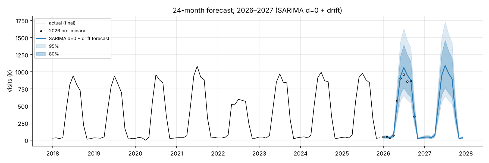

---

## 7. Q5 — North gate vs other entrances (adapted)

**Why adapted.** The brief asked whether winter traffic through the North/Northeast gates grows faster than at the West gate. In the IRMA traffic file the West, South and East gates record zero cars in winter (they are snowmobile-only, counted elsewhere), the Northeast gate is unstaffed, and the data start in 1993. North-gate winter cars were therefore compared with **Highway 191** (US-191 along the park's west edge, regional traffic rather than a wolf destination), winters 1994–2021. A new all-lane North counter from June 2021 makes later winters not comparable.

| Test on log North − log Highway 191 | Result |
|---|---|
| Step at winter 1996 (first free-roaming wolves), AR(1) errors | −1%, p = 0.96 |
| Step at winter 1997 (chosen after seeing the data) | +93%, p < 0.001 |
| Break tests, binary segmentation and PELT (dates chosen blind) | breaks at 1999 and 2009 |

North-gate winter cars doubled from 16.7k (winter 1996) to 33.8k (winter 1997). The blind break tests find a high plateau from 1999 to 2008 and a dip from 2009 to 2014, when wolf numbers were lowest. With only three pre-wolf winters and no snowmobile counts by gate, this supports but cannot prove a wolf effect on the northern range. The brief's comparison would need IRMA's oversnow counts by gate.

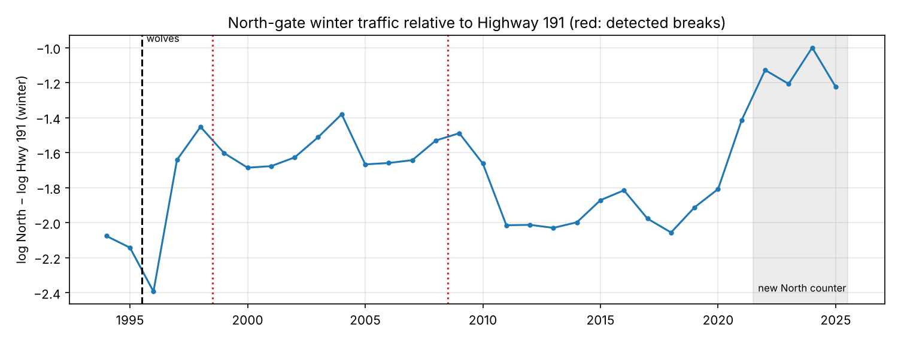

---

## 8. Limitations

- **Counting changes.** The 1993 and 2013 counting-method changes and the 2014, 2021 and 2022 counter replacements are controlled with dummies, but their true effect on each month is unknown.
- **Counterfactuals depend on the baseline.** Shock costs vary up to fourfold between SARIMA and ETS; the report gives ranges where the methods disagree.
- **Few yearly observations.** The wolf analyses rest on 25–46 yearly values, with two closely spaced level shifts (1993, 1996), so they have low power.
- **Temperature data.** The station count varies from 1 to 3, which can shift the monthly mean; temperature before 1984 is not available.
- **Heavy tails.** Model residuals are heavy-tailed, so p-values and constant-width forecast intervals are approximate.

**Links to the rest of the project.** Q1 is the human side of the trophic-cascade question (Parts 1 and 2). Q2 uses the same SNOTEL temperature and winter severity data as Part 2. The wolf counts come from Part 1.

---

## References

- Bates, J. M., & Granger, C. W. J. (1969). The combination of forecasts. *Operational Research Quarterly*, 20(4), 451–468.
- Box, G. E. P., & Tiao, G. C. (1975). Intervention analysis with applications to economic and environmental problems. *Journal of the American Statistical Association*, 70(349), 70–79.
- Box, G. E. P., Jenkins, G. M., Reinsel, G. C., & Ljung, G. M. (2015). *Time Series Analysis: Forecasting and Control* (5th ed.). Wiley.
- Cleveland, R. B., Cleveland, W. S., McRae, J. E., & Terpenning, I. (1990). STL: A seasonal-trend decomposition procedure based on loess. *Journal of Official Statistics*, 6(1), 3–73.
- Diebold, F. X., & Mariano, R. S. (1995). Comparing predictive accuracy. *Journal of Business & Economic Statistics*, 13(3), 253–263.
- Duffield, J. W., Neher, C. J., & Patterson, D. A. (2006). *Wolves and People in Yellowstone: Impacts on the Regional Economy*. University of Montana.
- Engle, R. F. (1982). Autoregressive conditional heteroscedasticity with estimates of the variance of United Kingdom inflation. *Econometrica*, 50(4), 987–1007.
- Fisichelli, N. A., Schuurman, G. W., Monahan, W. B., & Ziesler, P. S. (2015). Protected area tourism in a changing climate: Will visitation at US national parks warm up or overheat? *PLOS ONE*, 10(6), e0128226.
- Harvey, D. I., Leybourne, S. J., & Newbold, P. (1998). Tests for forecast encompassing. *Journal of Business & Economic Statistics*, 16(2), 254–259.
- Hyndman, R. J., & Athanasopoulos, G. (2018). *Forecasting: Principles and Practice* (2nd ed.). OTexts.
- Hyndman, R. J., & Koehler, A. B. (2006). Another look at measures of forecast accuracy. *International Journal of Forecasting*, 22(4), 679–688.
- National Park Service. IRMA Visitor Use Statistics, Yellowstone National Park (YELL). https://irma.nps.gov/Stats/ (accessed November 2026).

*The project brief asks that journal details be confirmed on Google Scholar before submission.*
