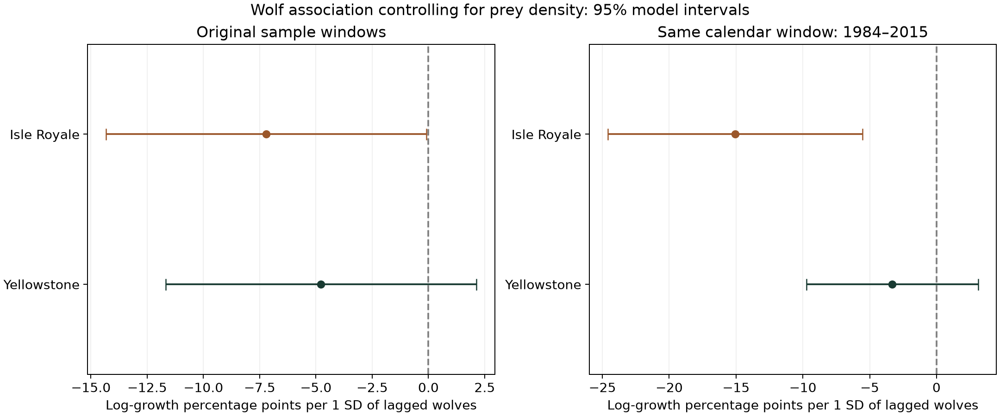
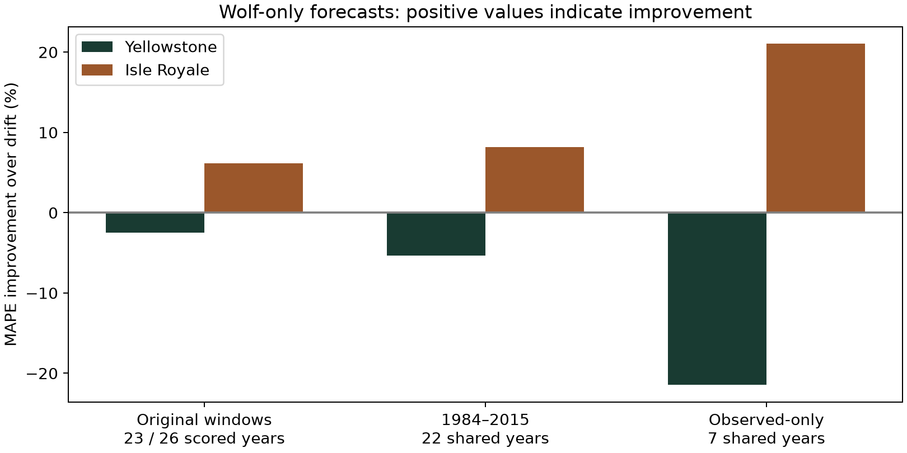

# Yellowstone–Isle Royale comparison

The comparison is complete for the supplied datasets. We re-ran both systems with Person 4's unchanged `tsa_spec.py` rather than juxtaposing the earlier Yellowstone results with different predictors.

## Matched specifications and results

The coefficient below is for lagged wolf **levels**, controlling for lagged log prey abundance. Units are log-growth percentage points per ten wolves, not exact percentage changes in animal numbers. Yellowstone's original headline used changes in wolf numbers, so these results supplement rather than replace that analysis. Both native-window model selections choose white-noise errors (see exported ARMA tables).

| Sample / system | Wolf coefficient [95% CI] | p | Wolf → prey Granger p | Forecast MAPE gain | Scored years |
|---|---:|---:|---:|---:|---:|
| native_windows / Yellowstone | -1.60 [-3.91, +0.71] | 0.175 | 0.142 | -2.49% | 23 |
| native_windows / Isle Royale | -8.04 [-15.96, -0.11] | 0.047 | 0.011 | +6.18% | 26 |
| common_1984_2015 / Yellowstone | -1.02 [-3.00, +0.96] | 0.312 | 0.530 | -5.31% | 22 |
| common_1984_2015 / Isle Royale | -23.66 [-38.61, -8.71] | 0.002 | 0.009 | +5.70% | 26 |
| common_observed_only / Yellowstone | -1.36 [-4.44, +1.71] | 0.384 | Not estimated | -21.45% | 7 |
| common_observed_only / Isle Royale | -23.66 [-38.61, -8.71] | 0.002 | Not estimated | +6.50% | 21 |

## Identical forecast years

| Sample | System | Shared years | MAPE gain over drift |
|---|---|---:|---:|
| common_1984_2015 | Yellowstone | 22 | -5.31% |
| common_1984_2015 | Isle Royale | 22 | +8.21% |
| common_observed_only | Yellowstone | 7 | -21.45% |
| common_observed_only | Isle Royale | 7 | +21.06% |
These scores restrict both systems to the same eligible calendar years within each scenario.

## Figures

The original-window bars use each system's eligible years. The two common-window groups use identical calendar years, matching the identical-year table above.

## Interpretation

The native-window Isle Royale analysis reproduces Person 4's supplied table exactly at its reported precision. Its density-adjusted wolf association is negative and marginally significant, and VAR(1) detects wolf-to-prey predictive information. Those results alone do not establish a stronger ecological effect than in Yellowstone: sample periods, populations, measurement practices and wolf histories differ. The common-window results and the observed-only sensitivity above show how conclusions depend on those choices. A difference between significant and non-significant p-values is not itself a significant difference between systems.

The legacy shared-specification column rescales by the SD of all wolf levels in the window. The graph and comparison_summary.csv instead use lagged wolves on the fitted sample, so their per-SD values differ slightly from that legacy column. Both conventions are labelled here. The per-standard-deviation graph rescales wolf coefficients using the lagged wolf series on each fitted sample. It reports model intervals, not a causal comparison or an area-adjusted predator-density effect. Forecast gains compare each model with drift on its own eligible years. Animal-count MAE is not comparable in scale between elk and moose, so MAPE gain is used here. Exact scored years and full diagnostics accompany the tables.

## Limitations and drawbacks

| Issue | Treatment / remaining drawback |
|---|---|
| Different original windows | Yellowstone 1984–2025, Isle Royale 1959–2015. Also rerun both on 1984–2015. These windows still mix ecological regimes. |
| Imputed Yellowstone inputs | Shared-specification replication includes filled training data. Separately exclude transitions with estimated/unresolved prey endpoints and imputed lagged wolves from the observed-only sensitivity. This reduces sample size and may introduce selection effects. |
| Calendar gaps | Form differences on intact annual grids. Full-data VAR uses contiguous years only. Do not fit a gap-compressed VAR in the observed-only sensitivity. |
| Forecast eligibility | Native replication excludes invalid targets. Strict sensitivity additionally requires valid origin counts, filters training transitions and excludes imputed lagged wolves. It uses fixed white-noise errors for both systems. Publication availability remains unverified. |
| Count and timing differences | Yellowstone northern wolf counts are December counts, whereas elk counts vary across winter. Shared lag-one convention does not make exposure windows identical to Isle Royale winter counts. |
| Reconstructed moose series | Person 4 flags the historical project series as reconstructed; its non-imputed flag does not imply a raw aerial count. Observed-only filtering cannot eliminate that difference. |
| Wolf regime and geography | Yellowstone includes pre-reintroduction zero wolves. Isle Royale's main sample ends in 2015 and excludes the later restoration period. Per-SD scaling does not harmonise park area or survey geography. |
| Optimizer warnings | Convergence flags are exported for every core model. Fits with optimizer warnings are retried using Powell on the same likelihood, without changing the shared module. The native Isle Royale density-only model and observed-only Yellowstone density-adjusted model required retries. The headline native Isle Royale wolf results reproduce the supplied table. Shared rolling forecast fits do not expose convergence diagnostics. |
| Sparse data and model uncertainty | Wald intervals and multiple exploratory tests require caution. No formal between-system causal-effect difference is asserted. |
| Viability | Yellowstone prey-count threshold scenarios and Isle Royale stochastic wolf-extinction simulations concern different species, thresholds and models. Their probabilities must not be ranked against each other. Comparable log-prey drift and volatility are exported separately. |
| Kill-rate data | Isle Royale's kill-rate template remains unfilled. A direct empirical cross-system kill-rate comparison is unavailable and is outside the completed population time-series comparison. |

## Reproduce and provenance

Run `python 04_isle_royale/comparison/scripts/build_comparison.py` from the repository root. The script preserves both source datasets and Person 4's code and outputs. It writes the Yellowstone handoff column, reproduced Isle Royale column, matched-window tables, diagnostics, forecasts, figures and input hashes. The supplied Isle Royale table is checked against the regenerated native-window column.

Sources: `01_yellowstone_elk_wolves/data/processed/yellowstone_master_ts_flagged.csv`; `04_isle_royale/data/processed/isle_royale_annual.csv`; `04_isle_royale/docs/model_settings.md`; `04_isle_royale/scripts/tsa_spec.py`; `04_isle_royale/reports/tables/IR_comparison_column.csv`.
